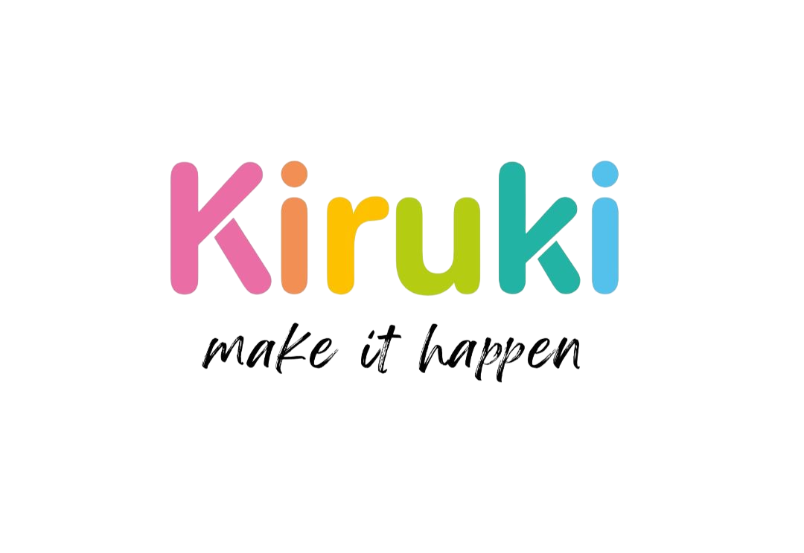
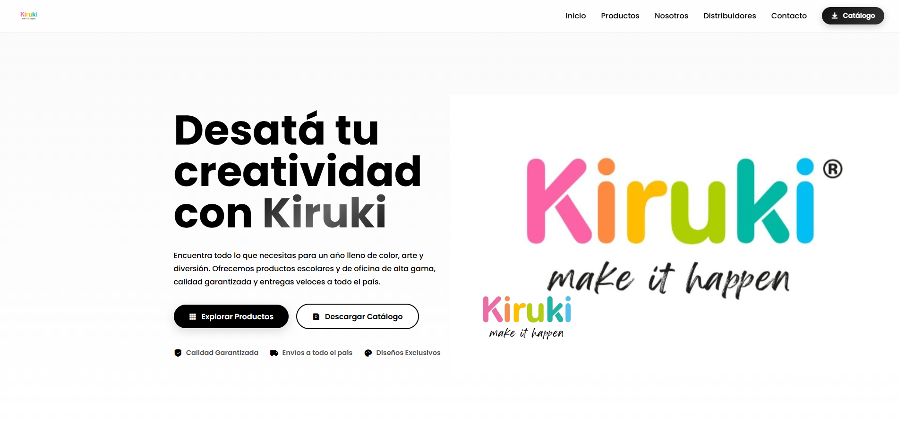
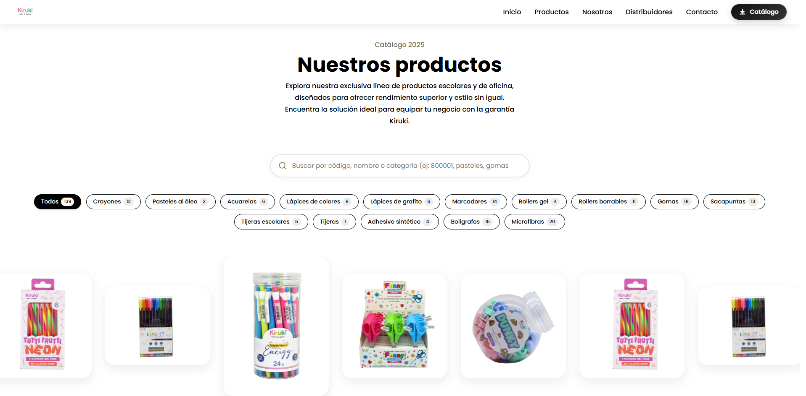
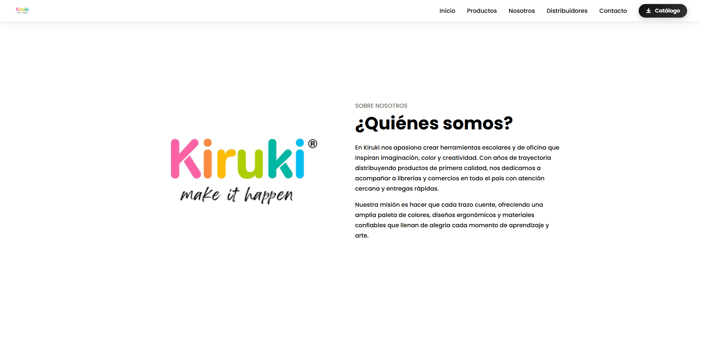
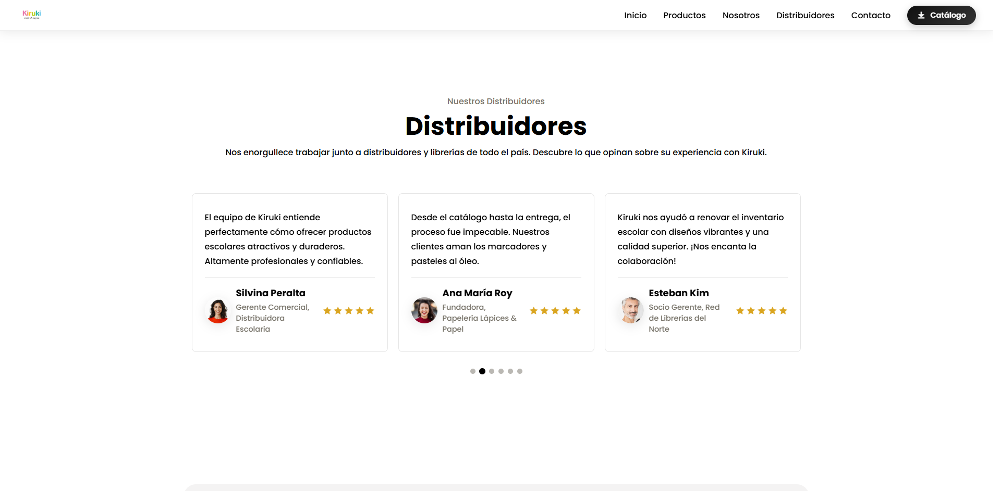
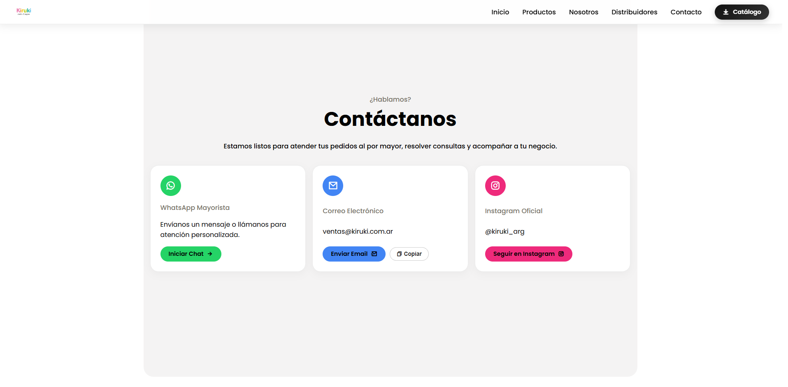

<p align="center">
  
</p>

> **Plataforma web corporativa y catálogo digital interactivo para productos escolares, de arte y oficina Kiruki.**

<p align="center">
  <a href="https://react.dev/"></a>
  <a href="https://vitejs.dev/"></a>
  <a href="https://greensock.com/gsap/"></a>
  <a href="https://swiperjs.com/"></a>
  
</p>

---

## 📸 Galería del Sitio Web

<table width="100%">
  <tr>
    <td width="50%" align="center">
      
      <br /><sub><b>Hero Principal — Inicio</b></sub>
    </td>
    <td width="50%" align="center">
      
      <br /><sub><b>Catálogo de Productos & Filtros</b></sub>
    </td>
  </tr>
  <tr>
    <td width="50%" align="center">
      
      <br /><sub><b>Sección Quiénes Somos</b></sub>
    </td>
    <td width="50%" align="center">
      
      <br /><sub><b>Red de Distribuidores Kiruki</b></sub>
    </td>
  </tr>
  <tr>
    <td width="100%" colspan="2" align="center">
      
      <br /><sub><b>Contacto Mayorista & Canales Directos</b></sub>
    </td>
  </tr>
</table>

---

## ✨ Destacados de la Plataforma

* 🎨 **Estética Premium & Glassmorphism:** Interfaz moderna con acabados translúcidos, tipografía limpia y gradientes dinámicos.
* ⚡ **Animaciones Fluidas (GSAP + ScrollTrigger):** Transiciones suaves y revelación progresiva de elementos al desplazarse.
* 🔍 **Buscador & Filtros en Tiempo Real:** Filtrado instantáneo por categorías y barra de búsqueda interactiva.
* 🛍️ **Modal Detallado de Producto:** Visualización ampliada con especificaciones técnicas, variantes y botón de consulta directa.
* 🔄 **Carruseles Interactivos (Swiper.js):** Muestrarios de productos y opiniones de distribuidores con interacción táctil.
* 📱 **Diseño 100% Responsivo:** Experiencia visualmente equilibrada tanto en escritorio como en dispositivos móviles.
* 💬 **Contacto Directo por WhatsApp:** Accesos rápidos para clientes mayoristas y descarga directa de catálogo en PDF.

---

## 🛠️ Stack Tecnológico

| Herramienta / Librería | Versión | Propósito |
| :--- | :--- | :--- |
| **[React](https://react.dev/)** | `18.3.x` | Biblioteca base para componentes reactivos y gestión de estado UI |
| **[Vite](https://vitejs.dev/)** | `5.4.x` | Entorno de desarrollo ultrarrápido y empaquetador de producción |
| **[GSAP](https://greensock.com/gsap/)** | `3.15.x` | Motor de animaciones avanzadas y ScrollTrigger para scroll suave |
| **[Swiper](https://swiperjs.com/)** | `11.1.x` | Carruseles móviles y sliders táctiles para productos y reseñas |
| **[Remix Icon](https://remixicon.com/)** | `4.5.x` | Iconografía vectorial consistente y ligera |
| **CSS3 Moderno** | — | Variables CSS nativas, efectos Glassmorphism y Flexbox/Grid responsive |

---

## 🚀 Instalación y Puesta en Marcha

Sigue estos sencillos pasos para clonar y ejecutar el proyecto localmente en tu máquina:

### Prerrequisitos
* **Node.js** (versión `18.0.0` o superior)
* Gestor de paquetes: **pnpm** (recomendado) o **npm** / **yarn**

### 1. Clonar el repositorio
```bash
git clone https://github.com/ramirolacci/Kiruki-Make-It-Happen.git
cd Kiruki-Make-It-Happen
```

### 2. Instalar dependencias
Con **pnpm** (recomendado):
```bash
pnpm install
```
*O alternativamente con **npm**:*
```bash
npm install
```

### 3. Iniciar el servidor de desarrollo
```bash
pnpm dev
# o con npm:
npm run dev
```

La aplicación estará disponible inmediatamente en tu navegador en:
```
http://localhost:3000
```

---

## 📜 Scripts Disponibles

En el directorio del proyecto puedes ejecutar los siguientes comandos:

| Comando | Descripción |
| :--- | :--- |
| `pnpm dev` | Inicia el servidor de desarrollo local con Hot Module Replacement (HMR) en el puerto `3000`. |
| `pnpm build` | Compila y optimiza la aplicación para producción en el directorio `/dist`. |
| `pnpm preview` | Sirve localmente los archivos compilados de `/dist` para probar la versión final de producción. |

---

## 📁 Estructura del Proyecto

Organización modular del código fuente:

```text
Kiruki-Make-It-Happen/
├── public/
│   ├── assets/              # Logotipos, íconos de medios de pago y fotografías
│   ├── catalogo-productos/  # Catálogo comercial en formato descargable (PDF)
│   └── screenshots/         # Capturas de pantalla de la plataforma para documentación
├── src/
│   ├── components/          # Componentes modulares reutilizables
│   │   ├── AboutSection.jsx        # Sección institucional "Quiénes Somos"
│   │   ├── ContactSection.jsx      # Formulario y accesos de contacto mayorista
│   │   ├── DistributorsSection.jsx # Red de distribución y testimonios
│   │   ├── Footer.jsx              # Pie de página y enlaces institucionales
│   │   ├── Header.jsx              # Hero principal y llamados a la acción
│   │   ├── Navbar.jsx              # Navegación fija con efecto translúcido
│   │   ├── ProductModal.jsx        # Ventana modal de detalle del producto
│   │   └── ProductsSection.jsx     # Grilla de catálogo con buscador y filtros
│   ├── data/
│   │   └── productsData.js  # Base de datos local de productos y categorías
│   ├── App.jsx              # Componente principal ensamblador
│   ├── main.jsx             # Punto de entrada de React en el DOM
│   └── style.css            # Sistema de estilos globales, variables y animaciones
├── index.html               # Plantilla HTML base
├── vite.config.js           # Configuración del servidor y plugins de Vite
└── package.json             # Manifiesto de dependencias y scripts de ejecución
```

---

## 🤝 Autor & Créditos

Desarrollado con dedicación para **Kiruki** por **[WaveFrame Studio](https://www.waveframestudio.com.ar)**.

© 2026 **Kiruki** — *Make It Happen*. Todos los derechos reservados.
